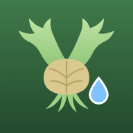

# ビカクログ 🌿💧

ビカクシダ（コウモリラン）の **重さ** を記録して、**水やりのタイミング** を教えてくれるアプリです。

- iPhone の Safari で「ホーム画面に追加」すると、ふつうのアプリのように使えます（パソコンのブラウザでも使えます）
- データは **あなたの Google スプレッドシート** に保存され、iPhone とパソコンで自動で同期されます
- 電波が弱い場所で記録しても、つながったときに自動で保存されます
- 毎朝7時に、水やりが必要な株を Gmail でお知らせします（該当する株がない日は送りません）



---

## 目次

1. [できること](#1-できること)
2. [しくみ](#2-しくみ)
3. [設置手順（はじめに1回だけ）](#3-設置手順はじめに1回だけ)
4. [使い方](#4-使い方)
5. [困ったとき](#5-困ったとき)
6. [安全のために](#6-安全のために)
7. [ファイル構成（参考）](#7-ファイル構成参考)

---

## 1. できること

| 機能 | 内容 |
| --- | --- |
| 株の登録 | 名前・品種・写真・置き場所・仕立て（板付け／鉢／ハンギング）・メモ |
| 計量の記録 | 日時・重さ（g）・種別（水やり前／水やり後／ふだんの計量）・メモ。大きな数字キーで片手で数秒で入力できます |
| 水やり判定 | 「水やり前」の重さの記録から **目安重量** を自動で計算（手動で上書きもできます）。直近の重さの減り方から **次の水やり予定日** を予測します |
| 色分け表示 | 一覧画面で 🔴「水やり時期」 🟡「もうすぐ」 🟢「まだ大丈夫」 を色とアイコンで表示します |
| グラフ | 株ごとの重さの推移・水やりのタイミング・目安重量・予測線を表示します |
| メール通知 | 毎朝7時、「水やり時期」「もうすぐ」の株があるときだけ Gmail に届きます |
| サンプルデータ | 設置前でも、サンプルの株3つ（60日ぶんの記録つき）で動作を試せます |

## 2. しくみ

```
 ┌───────────┐       ┌──────────────────┐       ┌───────────────────┐
 │ iPhone    │       │ Google Apps Script│       │ Google スプレッド  │
 │ パソコン   │ ───▶ │（合言葉をチェック）│ ───▶ │ シート（データ）   │
 │ (画面)     │ ◀─── │                  │ ◀─── │                   │
 └───────────┘       └──────────────────┘       └───────────────────┘
   GitHub Pages で公開      毎朝7時に判定して Gmail で通知
```

- **画面**（このリポジトリの `docs` フォルダ）は GitHub Pages で公開します。
- **データ** はあなたの Google ドライブにあるスプレッドシートに保存されます。
- 画面とスプレッドシートの間は Google Apps Script（`gas/Code.gs`）がつなぎます。**合言葉** が合っているときだけ読み書きできます。
- 合言葉と接続先のURLは **コードには書かず**、Apps Script の設定と、各端末の中だけに保存します。

---

## 3. 設置手順（はじめに1回だけ）

所要時間：30分くらい。むずかしいプログラミングは不要で、**コピー＆貼り付けとボタン操作だけ** です。
パソコンで作業するのがおすすめです（STEP 8 だけ iPhone を使います）。

### 用意するもの

- Google アカウント（Gmail を使っているアカウント）
- GitHub アカウント（このリポジトリがあるアカウント）
- パソコンと iPhone

---

### STEP 1　画面を公開する（GitHub Pages）

1. パソコンのブラウザでこのリポジトリのページ（`https://github.com/kushinon/bikaku-log`）を開きます。
2. 上のメニューの **⚙ Settings** をクリックします。
3. 左のメニューから **Pages** をクリックします。
4. 「**Build and deployment**」の「**Source**」が **Deploy from a branch** になっていることを確認します。
5. その下の「**Branch**」で、左のボックスを **main**、右のボックスを **/docs** にして、**Save** を押します。
6. 1〜5分待ってからページを再読み込みすると、上の方に
   「Your site is live at **https://kushinon.github.io/bikaku-log/**」と表示されます。
   この **アプリのURL** をメモしておきます。
7. そのURLを開いて、アプリの「はじめに」画面が出れば成功です。
   （ここで「サンプルデータで試してみる」を押すと、すぐに動作を見られます）

> 💡 表示されないときは、数分待ってからもう一度開いてください。最初の公開は少し時間がかかります。

---

### STEP 2　スプレッドシートを作る

1. ブラウザで <https://sheets.new> を開きます（新しいスプレッドシートが作られます）。
2. 左上の「無題のスプレッドシート」をクリックして、名前を **ビカクログ** に変えます。

> シートの中身（列の見出しなど）は、あとの STEP 5 で自動で作られるので、何も入力しなくて大丈夫です。

---

### STEP 3　Apps Script にコードを貼り付ける

1. スプレッドシートのメニューから **拡張機能 → Apps Script** をクリックします。新しいタブでエディタが開きます。
2. 左上の「無題のプロジェクト」をクリックして、名前を **ビカクログ** に変えます。
3. 別のタブでこのリポジトリの [`gas/Code.gs`](gas/Code.gs) を開きます。
4. コードの右上にある **コピーボタン**（四角が2つ重なったアイコン「Copy raw file」）を押します。
5. Apps Script のエディタに戻り、最初から入っている `function myFunction() { ... }` を **すべて消して**（Ctrl+A → Delete、Mac は ⌘+A → Delete）、
   コピーしたコードを **貼り付け**（Ctrl+V、Mac は ⌘+V）ます。
6. 上の **💾（プロジェクトを保存）** を押します。

---

### STEP 4　合言葉とタイムゾーンを設定する

1. Apps Script エディタの左端にある **⚙（プロジェクトの設定）** をクリックします。
2. 「**タイムゾーン**」が **(GMT+09:00) 日本標準時 - 東京** になっているか確認します。違っていたら選び直します。
   （毎朝7時の通知はこのタイムゾーンで送られます）
3. ページの一番下の「**スクリプト プロパティ**」で **スクリプト プロパティを追加** を押し、次のように入力します。

   | プロパティ | 値 |
   | --- | --- |
   | `PASSCODE` | あなたが決めた **合言葉**（例：`hinata-bikaku-2026` など、**8文字以上で他人に推測されにくいもの**） |

4. 必要なら、続けて次も追加します（どちらも省略できます）。

   | プロパティ | 値 | 説明 |
   | --- | --- | --- |
   | `APP_URL` | STEP 1 のアプリのURL | 通知メールに「アプリを開く」リンクが付きます |
   | `NOTIFY_EMAIL` | 通知を受け取るメールアドレス | 省略すると、あなたの Gmail に届きます |

5. **スクリプト プロパティを保存** を押します。

> ⚠️ 合言葉は、このあと iPhone とパソコンにも入力します。忘れないように、パスワード管理アプリなどに控えておいてください。
> 合言葉はコードやGitHubには書かないでください。

---

### STEP 5　初期設定を実行する（シート作成と毎朝の通知）

1. 左端の **<>（エディタ）** をクリックしてコードの画面に戻ります。
2. 上のツールバーにある関数の選択欄（「▶ 実行」の右）で **setup** を選び、**▶ 実行** を押します。
3. 初回は「**承認が必要です**」と出るので、次の順に進みます。
   1. **権限を確認** を押す
   2. 自分の Google アカウントを選ぶ
   3. 「**このアプリは Google で確認されていません**」と出たら、左下の **詳細** を押し、
      一番下の **「ビカクログ（安全ではないページ）に移動」** を押す
   4. 内容を確認して **許可**（または「続行」）を押す

   > 💡 「確認されていません」という表示は、**自分で作ったプログラム** を初めて動かすときに必ず出るものです。
   > このコードはあなたのスプレッドシートとメール送信だけを使い、他の人にデータを送ることはありません。

4. 画面下の「実行ログ」に「**シートの準備と、毎朝7時の通知の設定が終わりました。**」と出れば成功です。
   スプレッドシートを見ると「株」「記録」のシートができています。

---

### STEP 6　サンプルデータを入れる（動作確認用・おすすめ）

1. 関数の選択欄で **insertSampleData** を選び、**▶ 実行** を押します。
2. 「サンプルの株 3 件、記録 ○○ 件を入れました。」と出れば成功です。

サンプルの株は「水やり時期」「もうすぐ」「まだ大丈夫」の3つの状態になるように作られています。
動作を確認したら、STEP 11 で消せます。

---

### STEP 7　ウェブアプリとして公開する（デプロイ）

1. エディタ右上の **デプロイ** → **新しいデプロイ** を押します。
2. 「種類の選択」の横の **⚙** を押して **ウェブアプリ** を選びます。
3. 次のように設定します。

   | 項目 | 設定 |
   | --- | --- |
   | 説明 | `ビカクログ`（何でもOK） |
   | 次のユーザーとして実行 | **自分**（あなたのメールアドレス） |
   | アクセスできるユーザー | **全員** |

   > 「全員」にしても、**合言葉を知らない人はデータを見たり書いたりできません**。
   > 画面（GitHub Pages）から通信するために必要な設定です。

4. **デプロイ** を押します（ここでも承認を求められたら STEP 5 と同じように許可します）。
5. 表示された **ウェブアプリの URL**（`https://script.google.com/macros/s/……/exec`）の **コピー** を押して、メモしておきます。
6. 確認として、そのURLをブラウザで開くと「**ビカクログのサーバーは動いています。**」と表示されます。

> ⚠️ このURLも合言葉と同じく、他の人には教えないでください（GitHub に書き込むのもNGです）。

---

### STEP 8　iPhone のホーム画面に追加して接続する

1. iPhone の **Safari** で、STEP 1 の **アプリのURL**（`https://kushinon.github.io/bikaku-log/`）を開きます。
   （URLは、自分宛てのメールやLINE、AirDrop などで iPhone に送ると簡単です）
2. 画面下の **共有ボタン**（四角から上向きの矢印 ⬆️）を押します。
3. メニューを下にスクロールして **ホーム画面に追加** を押し、右上の **追加** を押します。
4. ホーム画面に増えた **ビカクログ** のアイコンからアプリを開きます。
5. **接続の設定をする** を押し、次の2つを入力して **接続して保存** を押します。
   - ウェブアプリのURL … STEP 7 でコピーしたURL
   - 合言葉 … STEP 4 で決めた合言葉
6. 「**接続できました！**」と出て、一覧にサンプルの株が表示されれば完了です 🎉

> 💡 **大事**：iPhone では、Safari で開いたときと、ホーム画面のアイコンから開いたときで、保存場所が別々になります。
> 接続の設定は **ホーム画面のアイコンから開いたアプリの中で** 行ってください。
>
> 💡 URL を手で入力するのは大変なので、パソコンでURLをコピーしてメールなどで iPhone に送り、
> iPhone でコピー → アプリの入力欄を長押しして「ペースト」すると簡単です。

---

### STEP 9　パソコンでも接続する

1. パソコンのブラウザ（Chrome・Safari・Edge など）で **アプリのURL** を開きます。
2. iPhone と同じように「接続の設定をする」から URL と合言葉を入力します。
3. iPhone で入れた記録が表示されれば、同期ができています。

> Chrome や Edge では、アドレスバーの右にある「インストール」ボタンでアプリのように使うこともできます。

---

### STEP 10　通知メールをテストする

1. Apps Script エディタで、関数の選択欄から **testNotice** を選び、**▶ 実行** を押します。
2. 数分以内に「【ビカクログ】……」というメールが届けば成功です。
   （メール送信の承認を求められたら、STEP 5 と同じように許可します）

以後、毎朝7時ごろ（±15分程度）に、「水やり時期」「もうすぐ」の株があるときだけメールが届きます。

---

### STEP 11　サンプルデータを消して、自分の株を登録する

サンプルが不要になったら、どちらかの方法で消します（消した結果は全端末に自動で反映されます）。

- **アプリで消す**：⚙ 設定 → **サンプルの株と記録を削除する**
- **Apps Script で消す**：関数の選択欄で **removeSampleData** を選んで **▶ 実行**

その後、一覧画面の **＋ 株を追加** から自分の株を登録してください。

---

## 4. 使い方

### 毎日の流れ

1. ビカクシダをはかりにのせて、アプリの一覧画面で株の **計量** ボタンを押します。
2. 大きな数字キーで重さを入れ、種別を選んで **保存** を押します。
   - **ふだん**：水やりをしない日の計量
   - **水やり前**：これから水やりするときの重さ（＝乾いたときの重さ）
   - **水やり後**：水やりして、水がしたたらなくなったあとの重さ
3. 「水やり前」を保存すると、自動で「水やり後」に切り替わるので、水やり後の重さを続けて記録できます。

> 💡 画面上部の株の名前を横にスクロールして押すと、別の株にすぐ切り替えられます。
> 日時を過去にしたいときは「日時・メモを変更」を開きます。

### 過去の記録を Google Keep などからまとめて取り込む

メモに書きためた計量の記録は、1件ずつ入れなくても **貼り付けるだけで取り込めます**。

1. 先に、その株を「＋ 株を追加」で登録しておきます。
2. 株の詳細画面の一番下（または ⚙ 設定）にある **「メモからまとめて取り込む」** を押します。
3. 取り込む株を選び、Keep のメモを **そのままコピーして貼り付け**、**「読み取る」** を押します。
4. 読み取り結果が一覧で出るので、種別（水やり前／水やり後／ふだん）が正しいか確認し、必要なら右の欄で直します。
5. **「○件を取り込む」** を押します。

読み取れる書き方の例：

```
• 日時: 2026/09/17 21:20
• 重量: 460g
• 9/18 21:48: 304g
• 9/18 22:30: 636g (水やり後)
• 10/4 19:30: 611g (4回目 水やり後)
```

- 1行に「日付・時刻・重さ（g）」があれば読み取ります。「日時: …」と「重量: …」が別々の行でも大丈夫です。
- （ ）の中はメモになります。「水やり」と書いてある行は「水やり後」になります。
- 種別が書いていなくても、前の記録より1割以上重くなっている行は「水やり後」とみなします（「満水」と書いてある行も「水やり後」です）。
- 「水やり後」の直前（6時間以内）の軽い記録は、自動で「水やり前」にします。
- 自動で決めた種別には ※ が付きます。違っていたら右の欄で直してください。
- 年が書いていない日付は、今年（未来の日付になる場合は去年）とみなします。
- 同じ日時・同じ重さの行は1件にまとめます（Keep でメモを何度も書き足して、同じ行が重なっていても大丈夫です）。すでに登録済みの記録はチェックが外れるので、同じメモを2回貼っても二重になりません。

### 仕立て直し・植え替えをしたとき

板を替えたり植え替えたりすると、株の重さががらっと変わります。そのときは、計量画面の **「日時・メモ・仕立て直し ▾」** を開いて
**「仕立て直し・植え替えをした」** にチェックを入れてから保存してください（ふつうは水やり後の重さと一緒に記録します）。

- その記録より **前の記録は、水やり判定（目安重量・予定日）に使わなくなります**。グラフや記録の一覧には残ります。
- メモに「仕立て直し」「植え替え」「板替え」「付け替え」のどれかが入っている記録も同じ扱いです。メモから取り込んだ記録にも効きます。

### 水やり判定のしくみ

- **目安重量**：その株の「水やり前」の記録のうち、**新しい5回ぶんの真ん中の値（中央値）** です。
  株の詳細画面で、手動で上書きすることもできます（「自動に戻す」で元に戻せます）。
- **次の水やり予定日**：最後の「水やり後」より後の計量から、重さの減り方（1日あたり何g減っているか）を計算し、
  目安重量になる日を予測します。水やり直後は余分な水が抜けて急に軽くなるので、「水やり後」の重さそのものは減り方の計算に使いません。
  記録が少ないときは、過去の水やりサイクル（水やり後 → 次の水やり前）の平均を使います。
- **色分け**
  - 🔴 **水やり時期**：目安重量以下になった、または予定日を過ぎた
  - 🟡 **もうすぐ**：予定日まで2日以内、または目安重量の +5% 以内
  - 🟢 **まだ大丈夫**：それ以外
  - ⚪ **記録が足りません**：「水やり前」の記録がまだない（目安重量を手動で入れれば判定できます）

> 予測をよくするコツ：「水やり前」と「水やり後」をセットで記録し、ふだんの計量も1〜2日に1回あると精度が上がります。

### 留守のときの水やり計画

旅行や帰省で家をあけるときは、一覧画面の一番下の **「🧳 留守のときの水やり計画」** を押して、出発と帰宅の日時を入れます。
株ごとに、次のどれかを表示します。

- ⚠️ **出発直前に水やりしても、帰宅前に乾きそう**：留守が長すぎる株。いつごろ乾きそうかと、対策のヒントを表示します
- 💧 **出発の直前に水やりを**：出発の日に水やりすれば、帰宅まで持つ株
- ✓ **何もしなくて大丈夫**：次の水やり予定が帰宅のあとの株
- … **記録が足りず判定できない**：「水やり前」「水やり後」の記録が少ない株

水やりしてから乾くまでの日数は、過去の水やりの間隔と、今の減り方から計算します。
予定を保存すると、帰宅するまで一覧画面の上にお知らせが出ます（予定はその端末だけに保存されます）。

### 水やり不足のお知らせ

「水やり後」の重さを保存したとき、これまでの水やり後の重さ（新しい5回の中央値）の **9割に届かない** と、
「💧 いつもより水が入っていないようです」と知らせます。吸った水の量（水やり後 − 水やり前）もあわせて表示します。

- 水苔が乾ききって水をはじいていることがあるので、もう一度たっぷり水やり（ソーキングなど）をしてから
  **「もう一度はかる」** を押すと、さっきの記録を新しい重さに置き換えられます。
- **「このままでよい」** を選ぶと、次の計量まで一覧のカードに「💧 水やり不足かも」と表示します。
- 「水やり後」の記録が3回以上ないと判定しません。仕立て直しの記録や、仕立て直しより前の記録とは比べません。

### いつもと違う乾き方のお知らせ

今回の水やりのあとの減り方が、過去の水やりの **同じ時期（水やりから同じくらいの日数）** と比べて
1.5倍以上速い、または0.6倍以下と遅いときに、一覧画面のカードに「⚠ 乾くのがいつもより速い／遅い」と表示します。

- 株の詳細画面に、今回といつもの1日あたりの減り方と、考えられる理由を表示します。
- 天気（地域）を設定していれば、天気による乾きやすさの違いは差し引いて比べます。
- 比べるには、過去に「水やり後 → 水やり前」のサイクルが3回以上必要です。仕立て直しより前のサイクルは使いません。
- 置き場所を変えたなど理由がわかっているときは、**「わかった（今回は表示しない）」** で、その水やりの間は表示しないようにできます。

### デザインの切り替え

はじめは、あざやかな緑・オレンジ・青を使った **ビビッド** なデザインです（iPhone では丸みのある書体で表示されます）。
落ち着いた見た目がよいときは、⚙ 設定の **「デザイン」** で **シンプル** に切り替えられます（端末ごとに覚えます）。
iPhone を「ダークモード」にしていると、どちらのデザインも暗い色で表示されます。

### 取り消し（元に戻す）

計量の保存、記録の修正・削除、株の削除、まとめて取り込み、アルバムの写真の削除のあとには、画面の上に
**「元に戻す」** ボタンが数秒間出ます。押し間違えたときは、これを押すと元に戻ります。

### 天気を考えた予測と、予測の精度

⚙ 設定の **「地域（天気）」** で「現在地を使う」か、地名で探して地域を選ぶと、天気も予測に使えるようになります
（[Open-Meteo](https://open-meteo.com/) の無料の天気データ。登録は不要です。iPhone とパソコンでそれぞれ設定します）。

- 気温と湿度から、その日の **乾きやすさ（飽差）** を計算します。乾きやすい日は速く、湿った日はゆっくり重さが減るとみなして、
  この先16日の天気予報を使って予定日を計算します。
- ただし、室内に置いている株などは天気の影響が小さいこともあります。そこで、株ごとに
  **過去の水やりサイクルで「天気を考えた予測」と「記録だけの予測」のどちらが当たっていたか** を確かめて、
  当たっていた方を自動で使います（確かめるには、水やり後 → 途中の計量 → 水やり前 のサイクルが2回以上必要です）。
- 株の詳細画面には、次のことが表示されます。
  - **予測の方法**：「記録から」または「記録＋天気（気温・湿度）」
  - **予測の精度**：過去のサイクルで、予定日が平均何日ずれていたか（例：±0.4日）
  - **今日の天気**：気温・湿度と、乾きやすさの目安

### 成長アルバム

株の詳細画面の **「成長アルバム」** で、株ごとに写真を何枚でも残せます。

- **「写真を追加」** で、その場で撮るか、写真ライブラリから選びます（何枚かまとめて選べます）。日付は写真の日付が入ります。
- 写真を押すと大きく表示され、前後の写真へ移動したり、日時・メモを変えたり、削除したりできます。
  その頃の重さも表示されます。**「一覧の写真にする」** で、一覧画面に出る写真を差し替えられます。
- **「最初と比べる」** で、いちばん古い写真と新しい写真を並べて、成長を見比べられます。
- 写真はスプレッドシートの **「アルバム」** シートに保存されます（1枚ずつ自動で小さくしてから保存します）。
  アルバムを使うには、サーバー用のコードの更新が必要です（下の「困ったとき」の「サーバー用のコードが更新されたとき」）。

### 同期の表示（画面右上）

| 表示 | 意味 |
| --- | --- |
| 🟢 同期済み | すべての記録がスプレッドシートに保存されています |
| 🟡 未送信 ○件 | 端末に保存済みで、送信を待っています（自動で送られます） |
| 🟡 オフライン | 電波がありません。つながると自動で送ります |
| 🔴 同期エラー | 合言葉やURLを確認してください（⚙ 設定に詳しい内容が出ます） |

表示を押すと、すぐに同期を試します。

---

## 5. 困ったとき

<details>
<summary><b>「接続できませんでした」と出る</b></summary>

- URL が `https://script.google.com/macros/s/` で始まり `/exec` で終わっているか確認してください。
- STEP 7 の「アクセスできるユーザー」が **全員** になっているか確認してください。
- 電波の状態を確認してください。
</details>

<details>
<summary><b>「合言葉が違います」と出る</b></summary>

- STEP 4 の `PASSCODE` と、アプリに入れた合言葉が完全に同じか確認してください（大文字・小文字、空白も区別されます）。
- 20回続けて間違えると、安全のため10分ほど受け付けが止まります。少し待ってからやり直してください。
</details>

<details>
<summary><b>「サーバーに合言葉（PASSCODE）が設定されていません」と出る</b></summary>

STEP 4 のスクリプト プロパティに `PASSCODE` を追加して保存してください。
</details>

<details>
<summary><b>合言葉を変えたい</b></summary>

1. Apps Script の ⚙ プロジェクトの設定 → スクリプト プロパティで `PASSCODE` の値を変えて保存します。
2. iPhone とパソコンのアプリで、⚙ 設定 → 合言葉 を新しいものにして「接続して保存」を押します。
</details>

<details>
<summary><b>スプレッドシートを直接編集した／行を消した</b></summary>

アプリの ⚙ 設定 → **サーバーから全データを読み直す** を押してください。
（ふだんはスプレッドシートを直接編集する必要はありません）
</details>

<details>
<summary><b>朝の通知が来ない</b></summary>

- 「水やり時期」「もうすぐ」の株がない日は送られません。STEP 10 の `testNotice` でメールが届くか確認してください。
- 迷惑メールフォルダに入っていないか確認してください。
- Apps Script の左端 **⏰（トリガー）** に `sendMorningNotice` があるか確認してください。なければ STEP 5 の `setup` をもう一度実行します。
</details>

<details>
<summary><b>サーバー用のコード（gas/Code.gs）が更新されたとき</b></summary>

1. STEP 3 と同じように、Apps Script のコードを新しい `gas/Code.gs` の内容に **全部置き換えて** 保存します
   （<https://raw.githubusercontent.com/kushinon/bikaku-log/main/gas/Code.gs> を開いて、すべて選択 → コピー → 貼り付け）。
2. 関数の選択欄で **`doGet`** を選んで **▶ 実行** を押します。承認の画面が出たら、STEP 5 と同じように許可します
   （必要な許可が変わったときだけ出ます。`doGet` はデータを変えません）。
3. **デプロイ → デプロイを管理** を開き、右上の **✏️（編集）** を押します。
4. 「バージョン」で **新バージョン** を選んで **デプロイ** を押します。

この方法なら **ウェブアプリのURLは変わらない** ので、iPhone やパソコンの設定はそのままで大丈夫です。
（「新しいデプロイ」を作るとURLが変わるので注意してください）
</details>

<details>
<summary><b>アプリの画面が新しくならない</b></summary>

- ⚙ 設定の **「最新版に更新する」** を押してください（ver.1.2.1 以降）。記録のデータは消えません。
- そのボタンがない古い版のときは、アプリを完全に閉じて（iPhone では画面の下から上にスワイプし、アプリを上に払う）開き直してください。
  GitHub に反映されてから最大10分ほどは古い画面が出ることがあるので、少し待ってから開き直すと確実です。
</details>

<details>
<summary><b>写真について</b></summary>

写真はスプレッドシートの1つのセルに入るよう、アプリが自動で小さく（長辺480ピクセル程度）してから保存します。
</details>

---

## 6. 安全のために

- このリポジトリは **公開** されていますが、コードの中に **合言葉・ウェブアプリのURL・スプレッドシートの情報は含まれていません**。
  - 合言葉 … Apps Script の「スクリプト プロパティ」に保存
  - ウェブアプリのURLと合言葉 … 各端末（iPhone・パソコン）の中だけに保存
- スプレッドシートはあなたの Google ドライブにあり、共有しない限り他の人は見られません。
- データの読み書きは、合言葉が合っているときだけできます。合言葉を何度も間違えると、しばらく受け付けを止めます。
- 合言葉やウェブアプリのURLを GitHub の Issue などに書き込まないでください。

---

## 7. ファイル構成（参考）

```
docs/                    … 画面（GitHub Pages で公開する部分）
  index.html
  css/style.css
  js/app.js              … 画面・端末への保存・同期
  js/shared.js           … 水やり判定とサンプルデータ（画面とサーバーで共通）
  js/importer.js         … Keep などのメモの読み取り
  sw.js                  … オフラインで開けるようにする仕組み
  manifest.webmanifest   … ホーム画面用の設定
  icons/                 … アイコン
gas/
  Code.gs                … Apps Script に貼り付けるコード（自動生成）
  src/server.js          … サーバー側の元のコード
tools/
  build-gas.js           … gas/src/server.js と docs/js/shared.js から gas/Code.gs を作る
tests/
  unit/                  … 水やり判定・メモの取り込み・天気・サーバーのテスト
  e2e/                   … 画面を実際に操作して確かめるテスト（iPhone の大きさのブラウザ）
  fixtures/              … テスト用の作り物の計量メモ
  helpers/               … Apps Script の模型など、テスト用の道具
.github/workflows/test.yml … GitHub に送るたびに自動テストを実行する設定
```

### 自動テスト

GitHub に変更を送るたびに、自動でテスト（判定・取り込み・サーバー・画面の操作）が実行されます。
結果はリポジトリの **Actions** タブで見られます（✅ なら問題なし、❌ ならどこかが壊れています）。

手元で実行するときは、Node.js（22 以降）を入れてから次のようにします。

```
npm install                       # 初回だけ
npx playwright install chromium   # 初回だけ（画面のテスト用のブラウザ）
npm test                          # 判定・取り込み・サーバーのテスト
npm run test:e2e                  # 画面の動きのテスト
```

テストのデータはすべて作り物で、実際の記録は使っていません。

コードを変更する人へ：`gas/src/server.js` か `docs/js/shared.js` を変えたら、`node tools/build-gas.js` を実行して `gas/Code.gs` を作り直してください。
画面のファイルを変えたら、`docs/sw.js` の `CACHE` の番号（`bikaku-v1` → `bikaku-v2`）を上げると、各端末で新しい画面に切り替わります。
